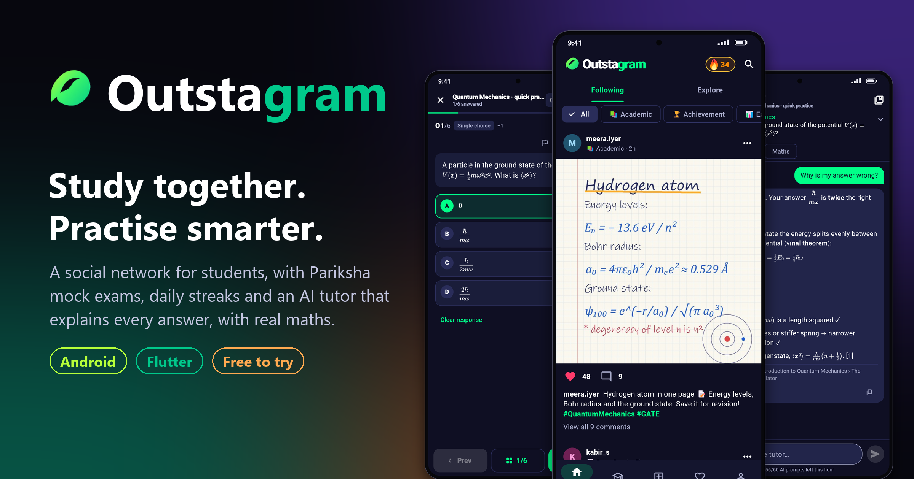
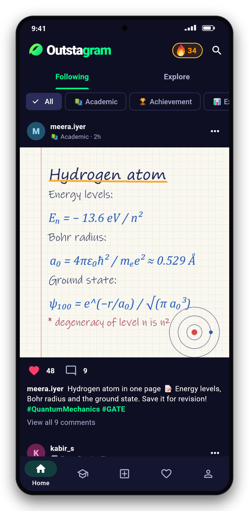
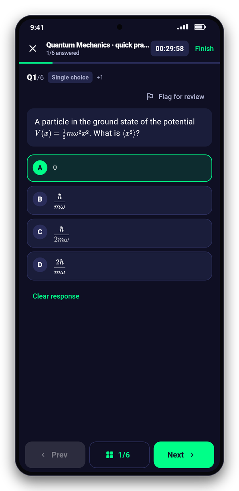
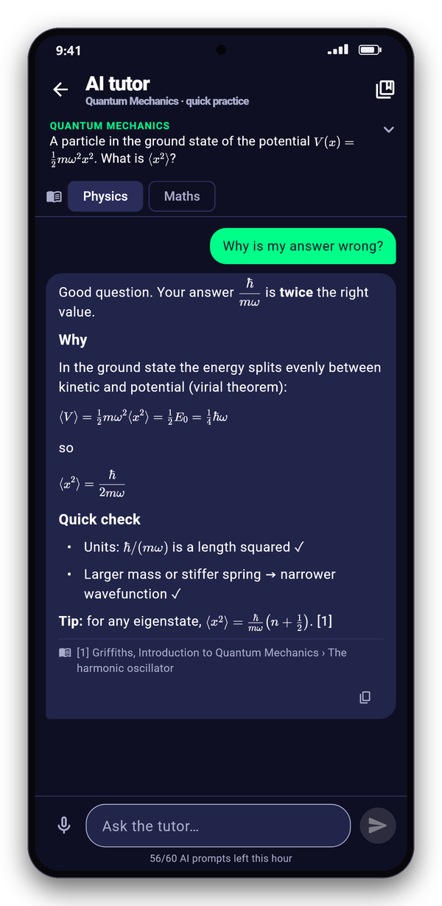
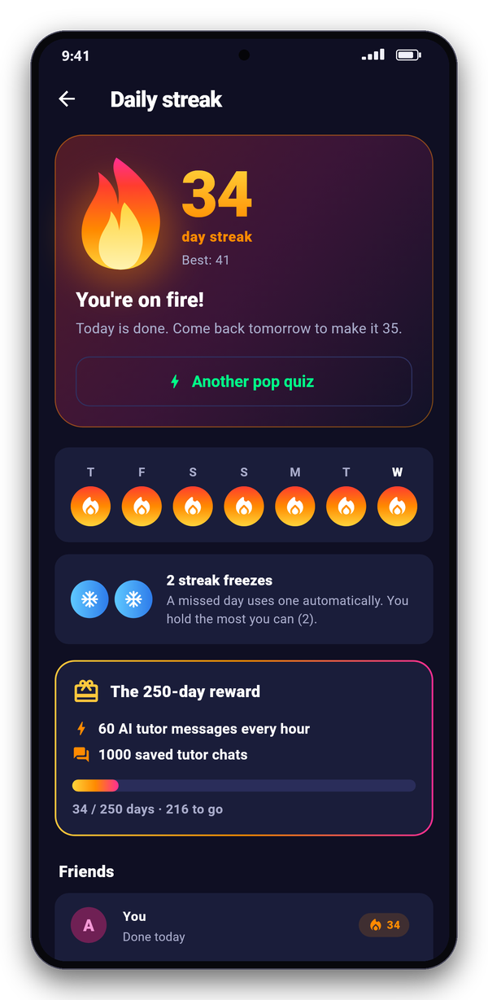
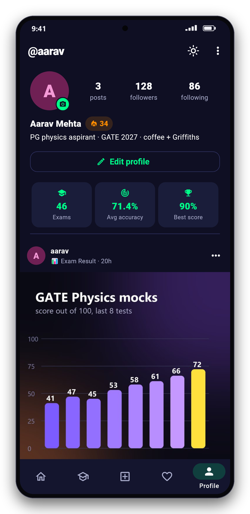
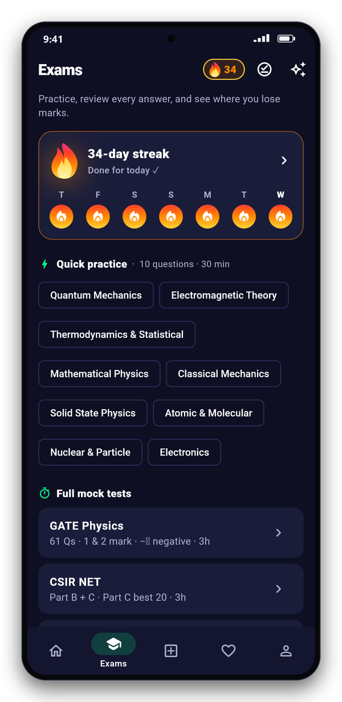

<p align="center">
  
</p>

<p align="center">
  <a href="https://github.com/silverstone-git/outstagram-mobile/releases/latest/download/Outstagram.apk"></a>
  <a href="https://github.com/silverstone-git/outstagram-mobile/releases/latest"></a>
  <a href="https://aryan.cfd/outstagram"></a>
</p>

**Outstagram** is a social network for students: share notes, results and wins with people who study what you
study, practise with **Pariksha** mock exams, keep a **daily streak**, and ask an **AI tutor** why an answer was wrong.
This is the Android app, built with Flutter. It talks to the same backend as the
[web app](https://github.com/silverstone-git/outstagram-web).

## A look inside

<table>
  <tr>
    <td align="center" width="33%"><br><b>Your feed</b><br><sub>Notes, results and wins from people you follow. Double-tap to like.</sub></td>
    <td align="center" width="33%"><br><b>Mock exams</b><br><sub>GATE, CSIR NET and quick practice. Real LaTeX, a timer, flags, and negative marking.</sub></td>
    <td align="center" width="33%"><br><b>AI tutor</b><br><sub>Ask about any question you got wrong. Answers stream in with maths and sources.</sub></td>
  </tr>
  <tr>
    <td align="center"><br><b>Daily streak</b><br><sub>One exam a day keeps it alive. Freezes cover a missed day, and friends' streaks keep you going.</sub></td>
    <td align="center"><br><b>Profile</b><br><sub>Your posts, followers and exam stats in one place.</sub></td>
    <td align="center"><br><b>Exams tab</b><br><sub>Quick practice by subject, full mocks, community papers and offline packs.</sub></td>
  </tr>
</table>

## Features

- **Social:** Following and Explore feeds, photo and video posts, likes, comments, hashtags, people search, follow
  requests, follower lists, and profile photos.
- **Pariksha exams:** presets for GATE, CSIR NET, TIFR and BARC, quick practice from a 1,100-question bank, and
  community exams. Scoring matches the web exactly. The results page shows strengths and weaknesses by topic, and
  you can review every answer.
- **AI tutor:** a chat for every question in a saved attempt, with streaming replies, Markdown + LaTeX, sources,
  subject chips, voice input, and saved equations.
- **Streaks:** daily streak with freezes, milestones, a 250-day reward, friends' streaks, local reminders, and a
  home-screen widget.
- **Phone extras:** share photos, videos or text into the app; App Links for posts and profiles; offline exam packs
  whose attempts upload later; result cards to share; and launcher shortcuts.
- **Plans:** Free, Pro and Contributor, with limits on photo/video size, posts and AI messages per hour.
- **Sign-in:** username and password, emailed 6-digit codes, or Continue with Google.

## Install

Download **[Outstagram.apk](https://github.com/silverstone-git/outstagram-mobile/releases/latest/download/Outstagram.apk)**
on your Android phone (Android 7+) and open it. Allow installs from your browser if Android asks.
Every build in [Releases](https://github.com/silverstone-git/outstagram-mobile/releases) is signed with the same key,
so a newer one installs over an older one and keeps you signed in.

> If you installed a build from before 25 Nov 2026 (build 1041 or older), uninstall it once first. Those builds
> were signed with a different key.

## Build from source

Requires Flutter 3.44 (stable) and the Android SDK.

```bash
flutter pub get
flutter run --flavor staging --dart-define-from-file=config/staging.json   # talks to the staging server
flutter run --flavor prod    --dart-define-from-file=config/prod.json      # talks to production

flutter build apk --release --flavor prod --dart-define-from-file=config/prod.json
# -> build/app/outputs/flutter-apk/app-prod-release.apk
```

Checks: `flutter analyze` and `flutter test`. CI runs both on every push. Every merge to `main` builds a signed
APK and publishes it as a GitHub release.

**Working on this repo (human or AI)? Start with [`AGENTS.md`](AGENTS.md).**

<details>
<summary>How the screenshots above are made</summary>

They are the real app, rendered in a Flutter test against demo data (`test/screenshots/`). Nobody's real posts or
photos are used, and the post images are drawn by `tool/screenshots/make_media.py`. To refresh them after a UI change
(on Windows, for the Segoe emoji font):

```bash
flutter test test/screenshots --update-goldens --dart-define=SCREENSHOTS=true
python tool/screenshots/compose.py      # phone frames + banner -> docs/screenshots/
```
</details>

## Docs

| | |
|---|---|
| [`AGENTS.md`](AGENTS.md) | Rules, status, repo map, commands, gotchas |
| [`docs/auth.md`](docs/auth.md) | Sign-in flows, sessions, Google/Supabase setup, troubleshooting |
| [`docs/api.md`](docs/api.md) | API endpoints and shapes the app uses |
| [`docs/environments.md`](docs/environments.md) | Staging vs prod, deploys, signing, devices |
| [`docs/qa.md`](docs/qa.md) | On-device QA loop and lessons |
| [`docs/TODO.md`](docs/TODO.md) | Roadmap and open work |
| [`PLAN.md`](PLAN.md) | Original architecture and phase plan |
